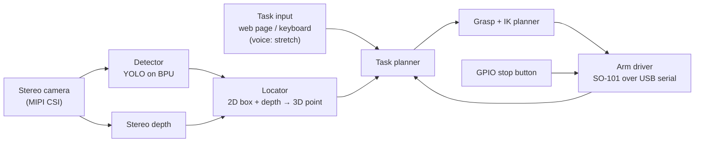
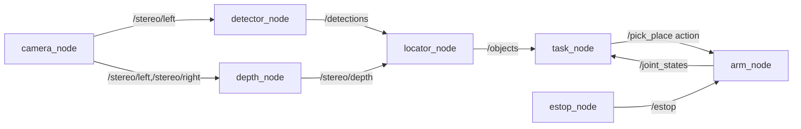

# Architecture

## Data flow

## Modules

| Module | Input | Output | Failure modes and handling |
|---|---|---|---|
| Camera | Stereo sensor | Left/right images | Camera drops out → stop motion, show "camera lost" |
| Detector | Left image | Boxes, class, confidence | Low confidence → don't act; ask to reposition |
| Stereo depth | Image pair | Depth map | Missing depth at the box → use the box's median over a patch; reject if still missing |
| Locator | Boxes + depth + camera-to-arm calibration | 3D points in the arm frame | Point outside the workspace → reject the target |
| Task planner | Request + located objects | Pick target and drop location | Object not found → report it and wait |
| Grasp + IK planner | Target point | Joint waypoints | Unreachable → report, don't move |
| Arm driver | Joint waypoints | Servo commands, joint feedback | Servo error or timeout → torque hold and stop |
| E-stop | GPIO button | Stop signal | Works without the planner; latched until reset |

## Compute allocation

| Work | Where it runs | Why |
|---|---|---|
| YOLO detection | **BPU** | The heaviest workload; the BPU keeps the CPU free |
| Stereo depth | BPU or CPU, decided at Stage 3 from measured speed | Use the RDK stereo pipeline if it runs on accelerated hardware; otherwise compute depth only inside detected boxes on the CPU |
| Locator, planner, IK | CPU | Light maths, a few times per task |
| Arm driver | CPU | Serial I/O at about 50 Hz |
| Web UI | CPU | Light |

No off-board service is required. Voice input (a stretch goal) would also run on the board.

## ROS 2 graph

| Node | Publishes | Subscribes | Rate |
|---|---|---|---|
| `camera_node` | `/stereo/left`, `/stereo/right` (`sensor_msgs/Image`) | | 30 Hz |
| `detector_node` | `/detections` (`vision_msgs/Detection2DArray`) | `/stereo/left` | ≥ 15 Hz |
| `depth_node` | `/stereo/depth` (`sensor_msgs/Image`) | `/stereo/left`, `/stereo/right` | ≥ 10 Hz |
| `locator_node` | `/objects` (`geometry_msgs/PoseArray` with labels) | `/detections`, `/stereo/depth` | ≥ 10 Hz |
| `task_node` | calls `/pick_place` | `/objects`, `/task_request` (`std_msgs/String`) | on request |
| `arm_node` | `/joint_states` (`sensor_msgs/JointState`) | `/estop` (`std_msgs/Bool`) | 50 Hz |
| `arm_node` (action server) | `/pick_place` (custom action: target pose + drop pose) | | on request |
| `estop_node` | `/estop` | GPIO | 100 Hz polling |

## Safety

- Joint speed is capped in the arm driver, and every target is checked against a workspace box before the arm moves.
- The GPIO stop button is read by its own node, and the arm driver also checks it before every servo command. A press latches the stop until it's reset by hand.
- Safe shutdown: the arm folds to its rest pose, then torque is released.
